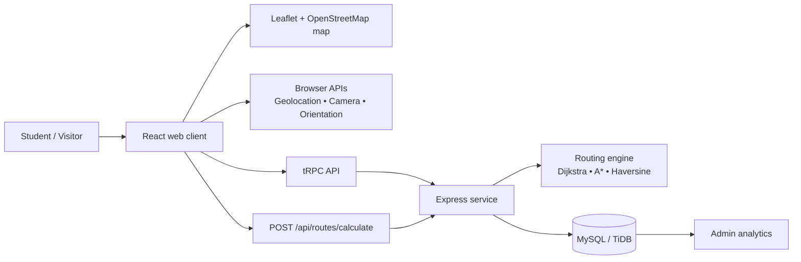

# PathFinder Smart Campus: Architecture and Submission Notes

## System view

The React client offers normal map navigation first and then attempts optional device capabilities. This ordering prevents a camera, compass, or geolocation limitation from blocking basic wayfinding. The Express server exposes both the project’s typed tRPC layer and the published REST compatibility route endpoint. The route engine consumes the graph model, filters unavailable edges, calculates a path, and returns both path data and instructions.

## Data model

| Group | Tables | Responsibility |
|---|---|---|
| Identity | `users` | OAuth-linked project users and `admin` role |
| Campus inventory | `buildings`, `floors`, `destinations` | Searchable, display-ready locations |
| Graph | `graph_nodes`, `graph_edges`, `blocked_paths` | Topology, weights, accessibility properties, and temporary closures |
| Route lifecycle | `routes`, `route_waypoints`, `navigation_history`, `route_deviations` | Planned route data, session results, and deviation analytics |
| Demand analytics | `destination_searches` | Genuine destination discovery demand |

Foreign keys deliberately protect graph relationships. Removing a graph node cascades into connected edges and dependent destination entries, so an administrator should review graph changes rather than deleting records casually.

## Request flows

### Destination-to-route flow

1. The user searches the catalog and applies category or building filters.
2. The chosen destination is saved in session storage and the user enters `/map`.
3. The map screen resolves the start node, requested destination, algorithm preference, and accessibility flag.
4. The route engine performs Dijkstra for graphs of `SMALL_GRAPH_NODE_THRESHOLD` nodes or below and A* above the threshold when `auto` is used.
5. The client displays a route polyline, ordered waypoint markers, distance, estimated time, and instructions.

### Live guidance flow

1. A user explicitly requests location. The client calls `navigator.geolocation.getCurrentPosition` and then `watchPosition` while navigation is active.
2. The user position includes latitude, longitude, accuracy, heading, speed, and timestamp when provided by the browser.
3. The route-deviation evaluator compares live position to route waypoints, applying `DEVIATION_THRESHOLD_METERS` and `REROUTE_COOLDOWN_MS`.
4. If the location exceeds the threshold and the cooldown is clear, PathFinder shows **“You're off the planned route.”** and enables recalculation.

### AR guidance flow

1. The user opens `/ar` and explicitly enables camera/motion capability.
2. The client derives geographic target bearing for the next waypoint.
3. It renders an overlay using `targetBearing − deviceHeading`, normalized to a display rotation.
4. If camera/orientation is declined or unsupported, the application directs the user to map navigation instead.

## Evaluation plan for the academic project

Test an approved campus graph with a representative set of outdoor, indoor, cross-building, floor-transition, blocked-path, and accessible-route cases. Record successful arrival, distance error, estimated-versus-observed time, route deviation frequency, location accuracy reported by the device, and user feedback through a real study protocol. Keep that study data distinct from the source-controlled demonstration seed.

| Test scenario | Expected behaviour |
|---|---|
| Permission denied | Clearly state that map guidance remains available; do not loop permission prompts |
| Location unavailable / timeout | State the issue and preserve destination/route preview |
| Low indoor accuracy | Surface the `±m` accuracy indicator and advise map-marker confirmation |
| Blocked edge | Exclude it from subsequent calculation |
| Route deviation over 20 m | Show the exact off-route notification and respect the reroute cooldown |
| AR unavailable | Preserve normal map experience without claiming AR success |
| Admin not promoted | Reject graph mutations server-side using the `admin` role |

## Deployment handover

The current demonstration build is suitable for review, screenshots, source inspection, and local functional demonstration. Before launch, appoint campus data owners, replace the sample graph, test published HTTPS origins and permission flows on target devices, configure a privacy notice and retention policy, complete security review, and execute the evaluation plan above.
